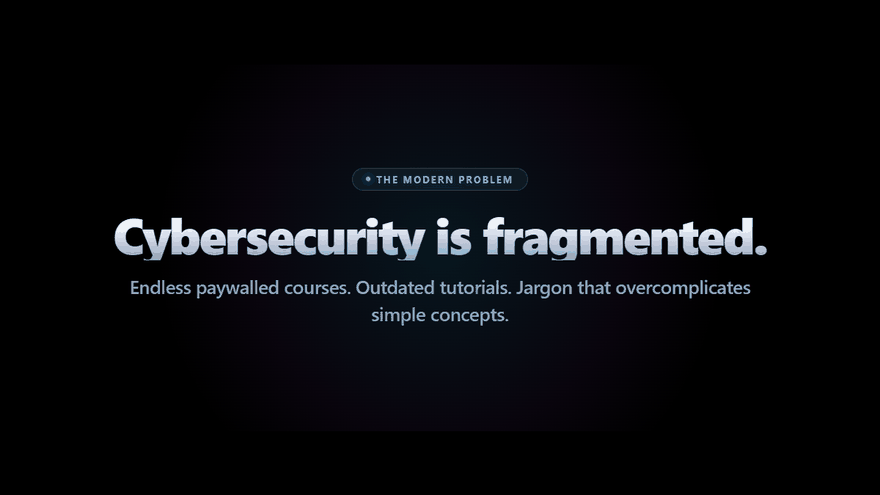

# SecOps: Cybersecurity Operational Engineering Field Manual

> **Defensive & Offensive Cyber Research Curriculum | Architecture & Telemetry Reference**  
> An advanced technical compendium spanning **154 structured modules** across 11 core security domains, isolated lab blueprints, defensive Sigma detections, and adversary emulation workflows.

---

  

---

## Overview

**SecOps** is a cybersecurity curriculum and operational field reference engineered to bridge conceptual theory with practical system-level security engineering. The project covers adversary tradecraft, low-level OS internals (Linux and Windows), memory structures, defensive telemetry detection pipelines (Sysmon, Wazuh, Sigma), and structured virtual lab blueprints.

* **Author Profile:** [cosmicbyt123](https://github.com/cosmicbyt123)

---

## Curriculum Matrix

The handbook encompasses 154 technical units organized across 11 core cybersecurity domains:

| Track Code | Domain | Modules | Focus Areas |
| :--- | :--- | :--- | :--- |
| **F** | **Foundations** | F1 - F12 | TCP/IP packet architecture, Linux/Windows OS internals, applied cryptography, shell scripting, threat modeling, and MITRE ATT&CK mapping. |
| **W** | **Web Application Security** | W1 - W22 | OWASP Top 10 vulnerabilities, advanced SQLi, XSS, CSRF, SSRF, XXE, insecure deserialization, command injection, SSTI, and HTTP request smuggling. |
| **PE** | **Privilege Escalation** | PE1 - PE15 | Linux capabilities, SUID abuse, Windows access tokens, UAC bypass techniques, credential dumping, Kerberoasting, and Active Directory exploitation. |
| **E** | **Evasion & Defense Bypass** | E1 - E18 | AV/EDR internal architecture, userland hook detection, direct/indirect syscalls, ETW patching, AMSI memory bypass, and anti-analysis patterns. |
| **M** | **Malware Analysis** | M1 - M15 | Static and dynamic triage, shellcode extraction, deobfuscation, YARA rule engineering, C2 protocol disassembly, and ransomware reverse engineering. |
| **T** | **Threat Emulation** | T1 - T10 | Adversary emulation planning, initial access execution, persistence mechanisms, command and control infrastructure, and atomic testing. |
| **WI** | **Wireless & RF Security** | WI1 - WI10 | 802.11 frame recon, WPA2/WPA3 handshake analysis, rogue access points, Bluetooth LE auditing, Software Defined Radio (SDR), and RFID/NFC protocols. |
| **H** | **Hardware & IoT Security** | H1 - H12 | UART, JTAG, and SPI serial interfaces, firmware extraction, BadUSB hardware design, fault injection concepts, CAN bus automotive auditing, and TPM validation. |
| **BT** | **Blue Team & SOC Operations** | BT1 - BT20 | SIEM telemetry ingestion, Snort/Suricata IDS signatures, incident response life cycle, memory forensics with Volatility, threat hunting, and Sigma rule design. |
| **PT** | **Purple Team Engineering** | PT1 - PT5 | Collaborative adversary simulation, detection validation workflows, automated telemetry testing, and security posture maturity metrics. |
| **S** | **Specialized Tracks** | S1 - S13 | Cloud security posture (AWS/Azure), mobile application auditing (Android/iOS), advanced OSINT methodologies, ICS/SCADA industrial protocols, and SOAR automation. |

---

## Technical Highlights

* **Detection Engineering:** Every offensive tradecraft unit is paired with defensive detection telemetry, event log IDs (Windows Event Log, Sysmon, Linux Auditd), and concrete Sigma detection rules.
* **Open-Source Lab Blueprints:** Step-by-step guides for constructing isolated virtual lab testing environments using VirtualBox, Docker containers, Kali Linux, Vulhub, and Wazuh SIEM without reliance on proprietary paid licenses.
* **Structured Learning Paths:** Methodical beginner roadmaps covering prerequisites from raw network capture analysis to compiled binary inspection.

---

## Project Background

This comprehensive knowledge base was generated, synthesized, and structured with the assistance of advanced artificial intelligence systems. It compiles and standardizes cybersecurity defense principles, industry standards, and technical research into a unified, referenceable curriculum.

---

## Legal Notice & Strict Disclaimer of Liability

Please read this section carefully before consulting any technical information referenced by this project:

1. **Defensive & Educational Intent Only:** All documentation, guides, scripts, and architectural patterns are compiled strictly for authorized educational research, defensive engineering, and isolated testing within virtual laboratory environments.
2. **Zero Author Liability:** The author and maintainers of this repository assume **zero liability** and are **not responsible under any circumstances** for any damage, data loss, service interruption, legal violation, or unauthorized activity resulting from the use, misinterpretation, or execution of any information described herein.
3. **100% User Responsibility:** Any individual who accesses, downloads, compiles, or executes any command or script bears sole and exclusive legal, civil, and technical responsibility for their actions.
4. **No Directives or Targeting:** Nothing in this repository or associated documentation constitutes operational direction, authorization, or inducement to target any computer system, device, or network.
5. **Mandatory Authorization:** Unauthorized testing, port scanning, or vulnerability exploitation against any system without prior explicit, written authorization from the verified system owner is strictly illegal under cybercrime laws worldwide.
6. **As-Is Provision:** All technical references and configurations are provided strictly "AS IS" without warranty of any kind. You execute and test all materials entirely at your own risk.

---

## Access & Inquiries

* **Author:** cosmicbyt123
* **GitHub Profile:** [https://github.com/cosmicbyt123](https://github.com/cosmicbyt123)
